# ✈️ SkyFlow Airlines — Frontend Application

[](https://airline-frontend-eight.vercel.app)
[](https://react.dev/)
[](https://vite.dev/)
[](https://tailwindcss.com/)
[](LICENSE)

A modern, responsive, and high-performance Single-Page Application (SPA) passenger portal and Airline Operations Control Center for the **SkyFlow Airline Microservice Platform**. Built with React 19, Vite, and Tailwind CSS v4, connecting securely to the centralized **SkyFlow API Gateway**.

---

## 🏗️ System Architecture

The frontend application connects **exclusively** to the **SkyFlow API Gateway**. All downstream microservices (Auth, Flight Search, Booking, and Notifications), databases, message queues, and circuit breakers are completely abstracted and secured behind the API Gateway perimeter.

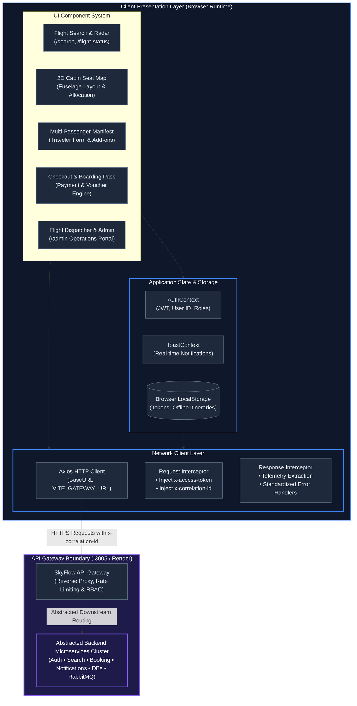

---

## 📸 Visual Walkthrough & Interface Showcase

Explore the SkyFlow Airlines interface through high-resolution captures of all primary application views, booking modals, and operations panels.

| Feature View | Screenshot Preview |
| :--- | :--- |
| **1. Flight Search & Dynamic Catalog**<br/>• Origin/destination airport selection<br/>• Real-time budget slider (₹2,000–₹10,000+)<br/>• Partner airline filters (Air India, Vistara, IndiGo) | 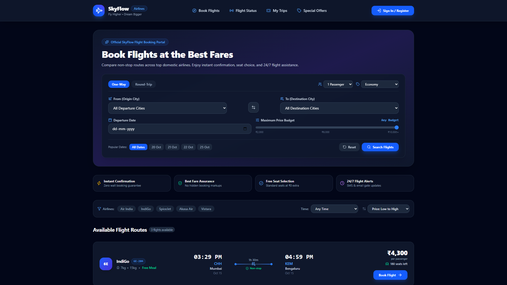 |
| **2. Multi-Passenger Booking & Vouchers**<br/>• Dynamic traveler manifest form (up to 6 passengers)<br/>• Baggage tiers (+15kg check-in, +25kg heavy load)<br/>• Real-time voucher discounts (`SKYFLOW10`) | 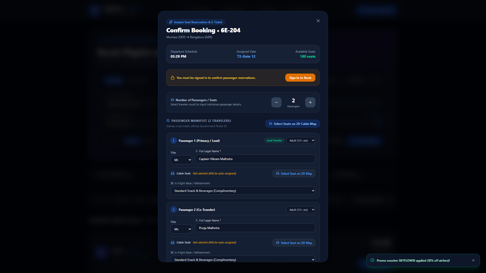 |
| **3. 2D Cabin Fuselage Seat Map**<br/>• Airbus A320neo cabin floorplan<br/>• Business Class (2-2), Economy (3-3), Exit Rows<br/>• Live occupied vs available seat indicators | 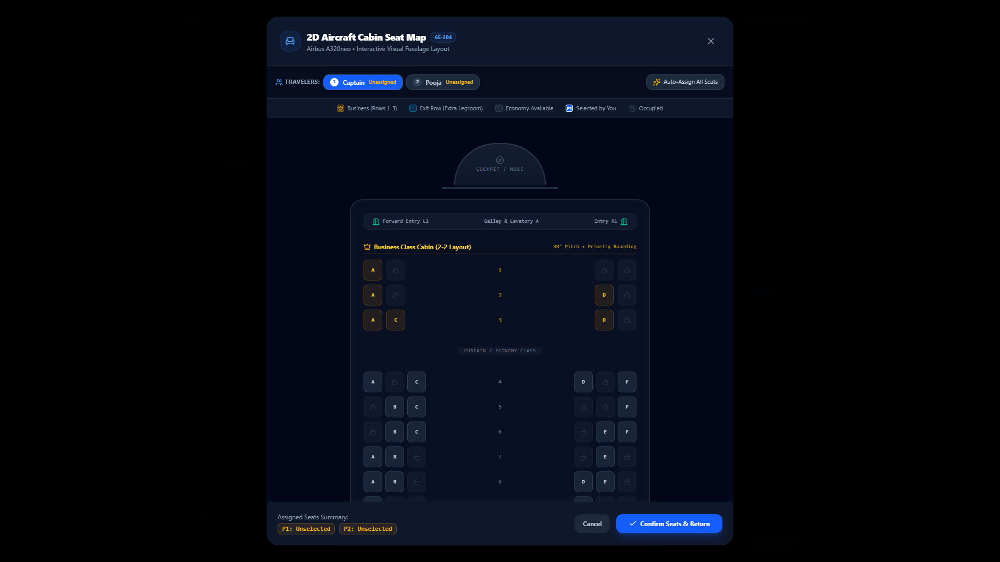 |
| **4. Digital Electronic Boarding Pass**<br/>• Instant PNR reference issuance (`SKF-0000X`)<br/>• Boarding gate terminal & barcode graphic<br/>• Multi-passenger traveler switcher tabs | 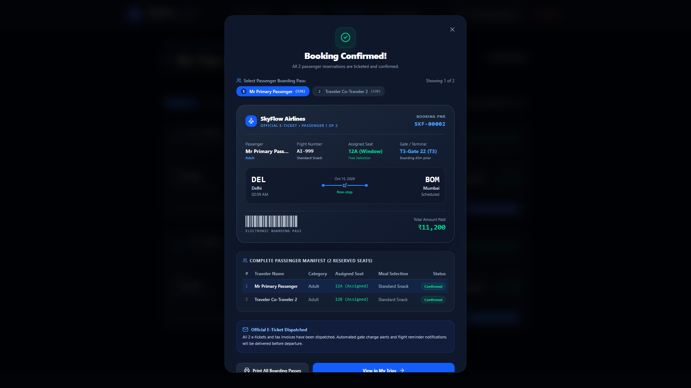 |
| **5. Live Flight Status Radar**<br/>• Real-time search by flight number or route<br/>• 6 operational milestone progress stages<br/>• Departure gate, baggage belt, destination weather | 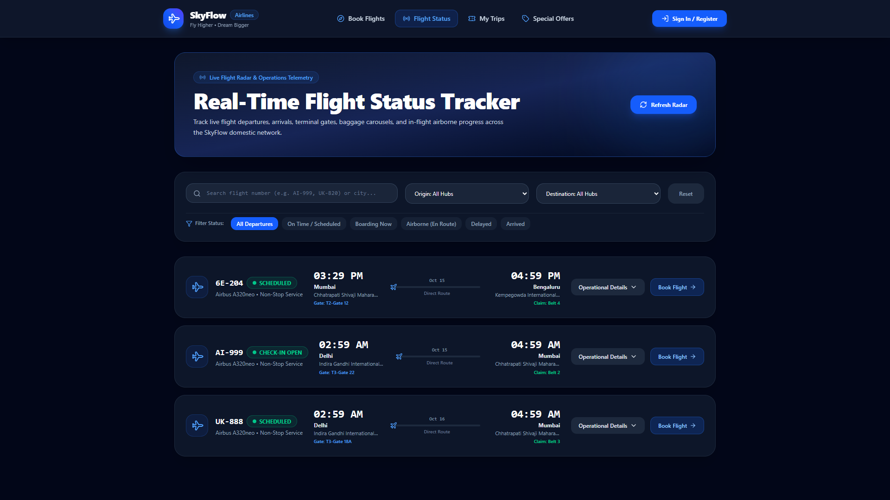 |
| **6. Promotional Deals & Hubs**<br/>• Hand-picked travel packages & seasonal discounts<br/>• Popular domestic route highlights | 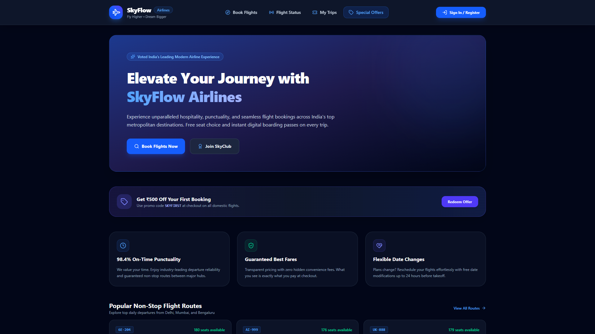 |
| **7. Passenger Authentication Portal**<br/>• Dual-tab sign-in and registration interface<br/>• Client-side validation & JWT session persistence | 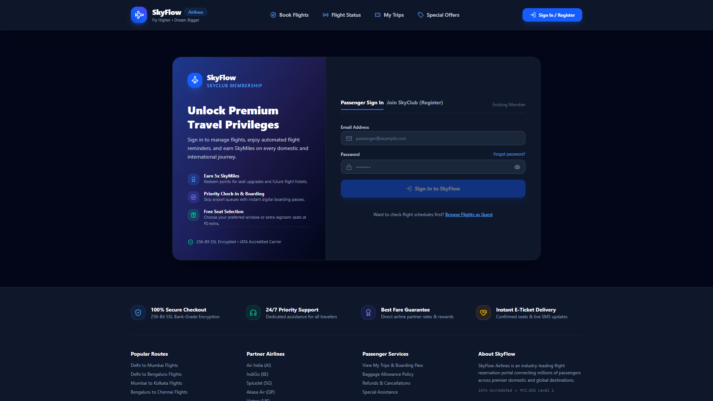 |
| **8. My Trips Dashboard**<br/>• Active customer itineraries & seat badges<br/>• Offline boarding pass retrieval<br/>• Self-service cancellation with distributed saga restock | 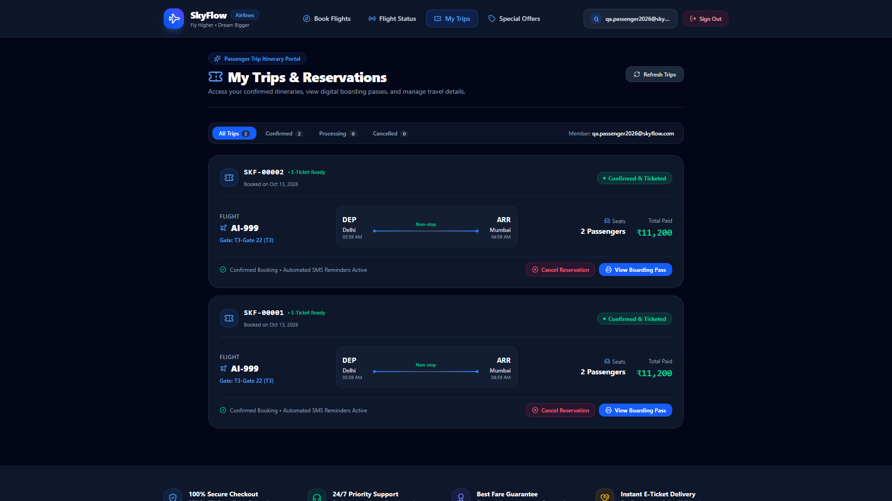 |
| **9. AOCC — Flight Dispatcher**<br/>• Schedule new flights & assign aircraft fleets<br/>• Departure/arrival slot time pickers & base fares | 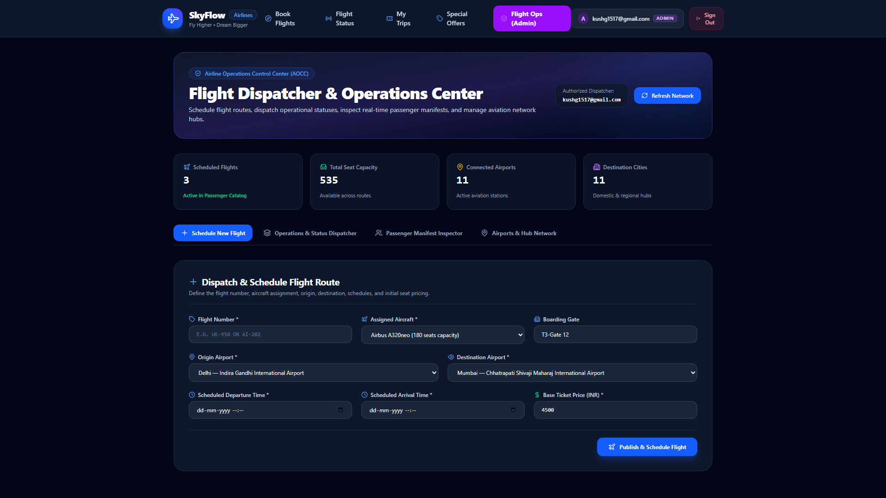 |
| **10. AOCC — Operations Status Dispatcher**<br/>• Real-time status broadcaster (`ON TIME`, `BOARDING`, `DELAYED`, `AIRBORNE`)<br/>• Synchronized with passenger radars | 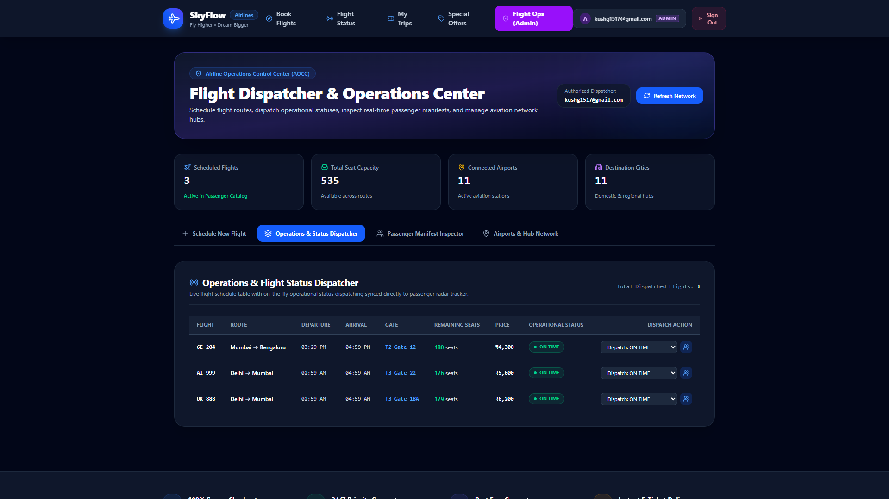 |
| **11. AOCC — Passenger Manifest Inspector**<br/>• Flight load factor % and gross revenue metrics<br/>• Full passenger manifest table with seat allocations | 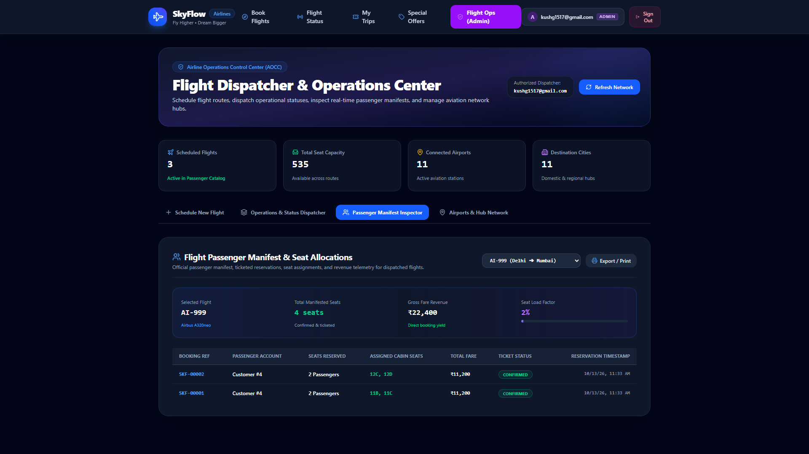 |
| **12. Microservice Health & Gateway Telemetry**<br/>• Real-time cluster health statuses<br/>• API Gateway uptime and memory telemetry | 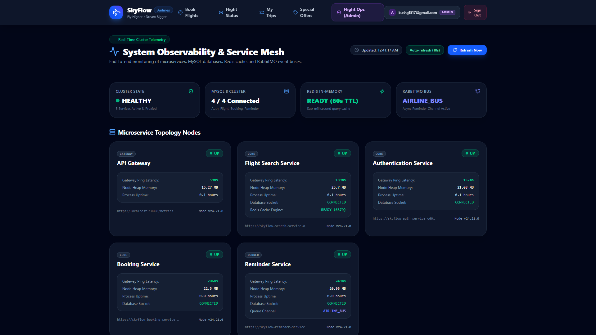 |

---

## ✨ Key Features & User Journeys

### 1. 🔍 Flight Discovery & Dynamic Filtering
- **Real-Time Route Lookup**: Instant matching between 11 connected airport hubs and destination cities.
- **Dynamic Filter Controls**: Reactive airline filtering (Air India, Vistara, IndiGo, SpiceJet), non-stop vs multi-stop filters, and interactive price slider.
- **Round-Trip Itinerary Selector**: Dual-date calendar picker with Outbound and Inbound leg switching.

### 2. 💺 Interactive 2D Aircraft Cabin Seat Map
- **Fuselage Visualization**: Cabin layout modeling Airbus A320neo configurations:
  - **Business Class** (Rows 1–3, 2-2 configuration)
  - **Emergency Exit Extra Legroom** (Rows 12–13)
  - **Standard Economy** (Rows 4–11, 14–30, 3-3 configuration)
- **Multi-Passenger Interactive Allocation**: Direct seat assignment with passenger switcher ribbon and deterministic fallback allocation.

### 3. 👥 Multi-Passenger Manifest & Ancillary Add-ons
- **Dynamic Traveler Manifest**: Individual name, title, category (Adult/Child), and dietary meal preference entry for up to 6 travelers.
- **Ancillary Add-on Engine**: Baggage tiers (Cabin 7kg free, Check-in 15kg @ ₹850, Heavy Load 25kg @ ₹1,450), SkyAssure travel insurance (₹299/seat), and Priority Boarding passes.
- **Airline Voucher Engine**: Real-time voucher calculation with immediate airfare discount (`SKYFLOW10` for 10% off, `FLYFIRST` for ₹500 off, `SUMMER2026` for 15% off).

### 4. 🎫 Digital Boarding Pass & Self-Service Trips
- **Instant Digital Boarding Pass**: Interactive e-ticket modal featuring PNR reference (`SKF-0000X`), departure gate, seat code badges, and traveler tabs.
- **Self-Service Trip Cancellation**: Passenger-driven cancellation with transparent refund calculation (90% net refund, 10% processing fee) and automatic distributed saga seat restock.

### 5. 📡 Flight Status Radar & Operations Dispatcher (`/admin`)
- **Live Flight Tracker (`/flight-status`)**: 6-stage operational milestone progress (`Scheduled` ➔ `Check-in Open` ➔ `Security & Gate` ➔ `Boarding` ➔ `Airborne` ➔ `Arrived`).
- **AOCC Operations Portal (`/admin`)**:
  - Live dispatch status controller (`ON TIME`, `BOARDING`, `DELAYED (15m/30m/60m)`, `AIRBORNE`, `ARRIVED`, `CANCELLED`).
  - Passenger Manifest Inspector showing booked passengers, assigned seats, ticket statuses, gross revenue, and flight load factor.
  - Route and fleet scheduler for publishing new flights.

---

## 🛠️ Tech Stack & Dependencies

| Category | Technology | Description |
| :--- | :--- | :--- |
| **Framework** | [React 19](https://react.dev/) | Component architecture and state lifecycle |
| **Build Tool** | [Vite 6](https://vite.dev/) | Lightning-fast HMR and optimized production bundling |
| **Styling** | [Tailwind CSS v4](https://tailwindcss.com/) | Modern utility-first responsive styling |
| **Routing** | [React Router v7](https://reactrouter.com/) | Client-side routing with protected route guards |
| **Icons** | [Lucide React](https://lucide.dev/) | Clean, consistent SVG icon system |
| **HTTP Client** | [Axios](https://axios-http.com/) | Interceptor-driven HTTP client with timeout management |
| **Hosting** | [Vercel](https://vercel.com/) | Edge-optimized global CDN deployment |

---

## 🌐 API Gateway Contract & Integration

The frontend connects directly to the API Gateway at `VITE_GATEWAY_URL`. Downstream paths:

| Frontend Route / Action | Gateway API Endpoint | HTTP Method | Auth Required | Description |
| :--- | :--- | :---: | :---: | :--- |
| **Sign Up** | `/authservice/api/v1/signup` | `POST` | No | Creates passenger account |
| **Sign In** | `/authservice/api/v1/signin` | `POST` | No | Returns JWT token |
| **Verify Session** | `/authservice/api/v1/isauthenticated` | `GET` | Yes (`x-access-token`) | Verifies user session validity |
| **Verify Admin Role** | `/authservice/api/v1/isAdmin?id={id}` | `GET` | Yes (`x-access-token`) | Checks if user has `ADMIN` role |
| **Search Flights** | `/flightservice/api/v1/flights` | `GET` | No | Queries available flights with filters |
| **Get Cities** | `/flightservice/api/v1/city` | `GET` | No | Retrieves destination cities |
| **Get Airports** | `/flightservice/api/v1/airports` | `GET` | No | Retrieves airport hubs |
| **Schedule Flight (Admin)** | `/flightservice/api/v1/flights` | `POST` | Yes (`ADMIN` role) | Creates new flight schedule |
| **Create Booking** | `/bookingservice/api/v1/bookings` | `POST` | Yes (`x-access-token`) | Creates reservation & deducts seats |
| **My Trips / Manifest** | `/bookingservice/api/v1/bookings` | `GET` | Yes (`x-access-token`) | Retrieves passenger bookings |
| **Cancel Booking** | `/bookingservice/api/v1/bookings/:id/cancel` | `PATCH` | Yes (`x-access-token`) | Cancels booking & restocks seats |

---

## ⚙️ Environment Variables

Create a `.env` file in the root of `airline-frontend`:

| Variable | Required | Default / Example | Description |
| :--- | :---: | :--- | :--- |
| `VITE_GATEWAY_URL` | **Yes** | `https://skyflow-api-gateway-vwri.onrender.com` | Full URL of the API Gateway reverse proxy. For local development, set to `http://localhost:3005`. |

---

## 🚀 Local Development & Setup

### Prerequisites
- **Node.js**: `v18.0.0` or higher
- **npm**: `v9.0.0` or higher
- **Running API Gateway**: Available on port `3005` (or live cloud URL)

### Step-by-Step Instructions

1. **Clone & Navigate:**
   ```bash
   cd airline-frontend
   ```

2. **Install Dependencies:**
   ```bash
   npm install
   ```

3. **Configure Environment:**
   ```bash
   cp .env.example .env
   # Ensure VITE_GATEWAY_URL is configured (e.g., http://localhost:3005)
   ```

4. **Start Development Server:**
   ```bash
   npm run dev
   ```
   The application will be accessible at: `http://localhost:5173`

5. **Build for Production:**
   ```bash
   npm run build
   ```
   Output files will be generated in the `dist/` directory.

6. **Preview Production Build Locally:**
   ```bash
   npm run preview
   ```

---

## 🐳 Docker Setup

To run the frontend in a containerized environment using Nginx:

```dockerfile
# Build Stage
FROM node:18-alpine AS builder
WORKDIR /app
COPY package*.json ./
RUN npm install
COPY . ./
RUN npm run build

# Production Stage
FROM nginx:alpine
COPY --from=builder /app/dist /usr/share/nginx/html
COPY nginx.conf /etc/nginx/conf.d/default.conf
EXPOSE 80
CMD ["nginx", "-g", "daemon off;"]
```

```bash
# Build and run Docker image
docker build -t skyflow-frontend .
docker run -p 5173:80 -e VITE_GATEWAY_URL=http://localhost:3005 skyflow-frontend
```

---

## 📄 License
This project is licensed under the MIT License.
